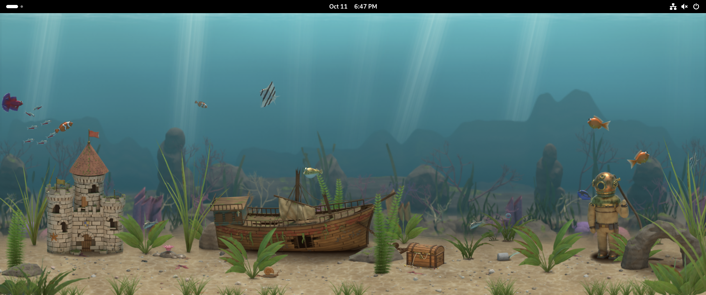

# Interactive Wallpaper

This turns your GNOME desktop background into a little living world that notices what you're doing. The first world is a fishtank. Fish wander around and loosely hang out together. When you move your mouse over the empty desktop, some of them swim over to see what you are and some dart away. Drag a window across the tank and the fish scatter out from under it. Walk away for a while and they settle down and doze, then come say hi when you're back. At night the tank goes dim and blue, a notification sends up a little burst of bubbles, and if you click the empty desktop you drop in some food. Fish you feed get braver over the following days and slowly grow.

It's meant to be calm and to cost almost nothing to run. There's no video playing and no hidden web browser. Everything is drawn by GNOME itself, so there's no separate program in the background. All the art was modeled and rendered ahead of time in Blender, so your computer only has to slide pictures around, and the whole tank fits in about 40 MB of memory. It stops completely whenever you can't see it (a window covers the screen, you open the overview, the screen locks or goes dark) and slows down once you've been idle for a minute.

## What you need

GNOME 45 or newer, on any Linux that ships it. That includes Debian 13 and later, recent Ubuntu, and Fedora. It's built and tested on Wayland; X11 should work but hasn't been tested much.

## Install it

Grab the code and install it:

    git clone https://github.com/lil-klorox/gnome-interactive-wallpaper
    cd gnome-interactive-wallpaper
    make install

GNOME only notices new extensions when you log in, so log out and back in, then switch it on:

    gnome-extensions enable interactive-wallpaper@lil-klorox

If you ever want to pick a different scene, open its settings with `gnome-extensions prefs interactive-wallpaper@lil-klorox`.

To remove it, run `gnome-extensions uninstall interactive-wallpaper@lil-klorox`.

## Try it without touching your desktop

`./dev.sh` opens a separate test copy of GNOME in a window, with the wallpaper already running, so you can play with it without changing anything on your real desktop. `./dev.sh --headless 40` runs that test copy invisibly for 40 seconds and saves a few screenshots plus a small file with the memory and speed numbers. `make check` runs the quick logic tests, which don't need GNOME at all.

If something looks wrong, the wallpaper writes short notes to GNOME's log, which you can watch with `journalctl -f /usr/bin/gnome-shell`.

## Make your own world

The fishtank is just the first scene. A scene is one folder with one function in it: the platform hands it a spot on the background, the pictures it asked for, and a simple running summary of what's happening on your desktop (where the mouse is, which windows are moving, how long you've been away, what time it is). The scene decides how to react. The platform takes care of everything else, like shrinking oversized art to fit your screen, sharing pictures between monitors, keeping memory in check and pausing when nobody's looking.

[docs/writing-a-scene.md](docs/writing-a-scene.md) walks through a tiny example scene from start to finish, and [DESIGN.md](DESIGN.md) explains how all the pieces fit together. If you make something you like, open a pull request.

## License

GPL-2.0-or-later. See [LICENSE](LICENSE).
