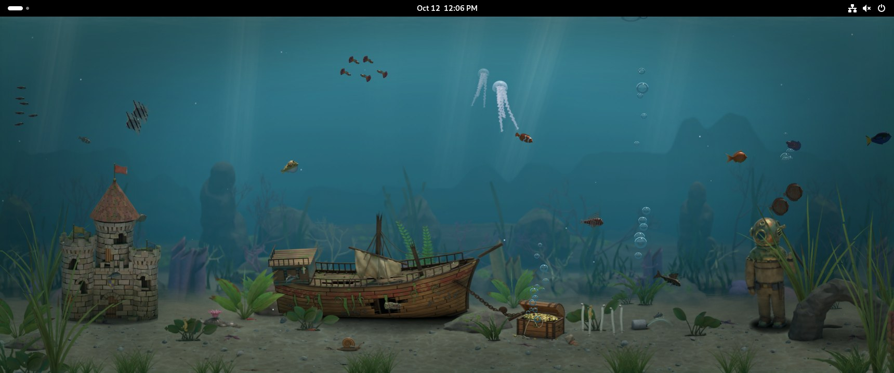
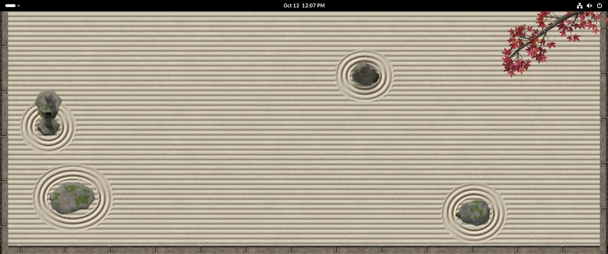

# Interactive Wallpaper

A small engine for living wallpapers on GNOME. Instead of a picture that just sits there, your
desktop shows a scene that notices what you do: where your mouse is, which windows you drag around,
when you step away and when you come back. It runs inside GNOME Shell itself, so there's no video
playing, no hidden web browser and no extra program in the background, and it stops completely
whenever nobody can see it.

The engine handles the hard parts (memory, speed, multiple monitors, settings, the lock screen) once,
so a scene is just one folder of art and a short script. It comes with two scenes, and you can write
your own.

**Fishtank**: fish, jellyfish, eels and more that swim over to look at your mouse, scatter from
dragged windows and race for food when you click.

**Sand garden**: a zen garden seen from above that you rake with your mouse.

## Install it

You need GNOME 45 or newer (Debian 13 and later, recent Ubuntu and Fedora all ship it). It's built
and tested on Wayland; X11 should work but hasn't been tested much.

The quickest way is to download `interactive-wallpaper@lil-klorox.shell-extension.zip` from the
[latest release](https://github.com/lil-klorox/gnome-interactive-wallpaper/releases/latest) and run:

    gnome-extensions install --force interactive-wallpaper@lil-klorox.shell-extension.zip

Or build it from the source, which also adds an "Interactive Wallpaper" entry to the app search:

    git clone https://github.com/lil-klorox/gnome-interactive-wallpaper
    cd gnome-interactive-wallpaper
    make install

GNOME only notices new extensions when you log in, so log out and back in, then switch it on:

    gnome-extensions enable interactive-wallpaper@lil-klorox

## Use it

Open Quick Settings (the menu in the top-right corner). The **Wallpaper** tile turns the live
wallpaper on and off, and its arrow lets you pick a scene or open **Wallpaper settings…**. You can
also find the settings by searching "Interactive Wallpaper" in the Activities overview. The settings
window shows the knobs for the scene you picked, like when the tank lights go off, how many of each
fish you want, or which critters live there. "Reset to defaults" puts them all back.

While a scene runs, a still picture of it (its "poster") becomes your normal GNOME wallpaper, so the
lock screen, the overview and switching workspaces show the same scene instead of a plain blue
background. Turning the live wallpaper off, or turning the extension off, puts your own wallpaper
back. One catch: if GNOME switches the extension off by itself, for example after a crash, your old
wallpaper isn't put back. Pick it again in Settings → Appearance.

If you installed the zip, remove it from the Extensions app; your own wallpaper comes back. If you
built it from source, run `make uninstall` instead: it puts your own wallpaper back and also removes
the search entry. (Removing a source install from the Extensions app leaves the search entry behind;
delete `~/.local/share/applications/interactive-wallpaper.desktop` to get rid of it.)

If something looks wrong, the extension writes short notes to GNOME's log, which you can watch with
`journalctl -f /usr/bin/gnome-shell`.

## The scenes

**Fishtank.** Fish wander around and loosely hang out together, and each kind moves its own way.
Move your mouse over the empty desktop and some swim over to see what you are while others dart
away. Click the empty desktop and food drops in: flakes tumble and sink, fish race for them, and the
bottom feeders tidy up what lands on the sand. Drag a window across the tank and the fish scatter
out from under it. The lights follow a schedule you can set, a notification sends up a burst of
bubbles, and fish you feed get braver over the following days and slowly grow.

Double-click the glass and the fish startle, hold the button down to pour food, and at night your
cursor becomes a flashlight the small fish drift toward. The fish you feed most turns tame and comes
to say hi, and once a day something small and rare might happen, like baby fish hatching. Jellyfish,
eels, seahorses, shrimp and a hermit crab live in there too. All of its art was modeled and rendered
ahead of time in Blender, so your computer only has to slide pictures around.

**Sand garden.** A calm zen garden seen from above. Drag with the mouse button held and you rake
grooves into the sand, which slowly smooth back out over the hours. Raked rings sit around the
stones, windows press their own rings into the sand and leave furrows when you drag them, and a
notification drops a leaf from the branch in the corner. Pick the season, the stones and the border
in settings, and the stone lantern lights up at night.

**Dot** is a tiny demo for people writing scenes: one dot that follows your mouse. It's there to
show how a scene is built.

## What the engine does

Each wallpaper is a "scene" that plugs into the engine. Everything hard is done once by the engine,
so no scene has to get it right on its own:

- it shrinks art to fit your screen, and keeps shrinking until the whole scene fits a memory budget
  of 100 MB
- it loads pictures in the background, so the desktop never stutters while art loads, and keeps the
  scene hidden behind its poster until the pictures are ready
- it shares one copy of each picture across all your monitors
- it draws 30 frames a second in step with your screen while you can see it, and nothing at all when
  you can't: a window (or a few tiled side by side) fills the screen, the overview is open, the
  screen is blank or locked
- it runs a watchdog, which means a scene that throws an error gets stopped and one that keeps
  running too slowly takes a short break, while the rest of your desktop carries on as normal. If a
  scene keeps having problems it stays off until you turn the live wallpaper off and on

A scene only ever sees where the mouse is, where windows are (never what's in them), how long you've
been away, the time and whether dark style is on. It never sees window titles or what a notification
says.

For now it only runs scenes that ship in this repo. There's no folder where you can drop in someone
else's scene, because a scene runs inside GNOME Shell with the same access the shell has, and that's
not something to hand to code you haven't read.

## Make your own scene

A scene is one folder with one function in it. The engine calls it once to build your things, then
about 30 times a second with a fresh summary of the desktop, and you move your things around. Your
scene's settings are a short list the engine turns into rows in the settings window for you.
[docs/writing-a-scene.md](docs/writing-a-scene.md) walks through the dot scene from start to finish
and covers art, settings, the lights schedule, posters and the few rules the engine enforces.
[DESIGN.md](DESIGN.md) explains how all the pieces fit together. If you make something you like,
open a pull request and it can ship with the next version.

## Try it without touching your desktop

`./dev.sh` opens a separate test copy of GNOME in a window, with the wallpaper already running, so
you can play with it without changing anything on your real desktop. `./dev.sh --headless 40` runs
that test copy invisibly for 40 seconds and saves a few screenshots plus a small file with the
memory and speed numbers. `make check` runs the quick logic tests, which don't need GNOME at all.

## License

GPL-2.0-or-later. See [LICENSE](LICENSE).
